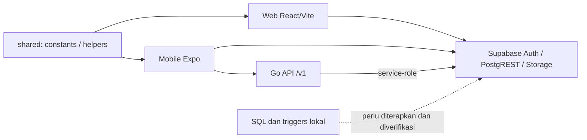

# Arsitektur dan alur bisnis

## Komponen

| Bagian | Teknologi dalam manifest lokal | Tanggung jawab |
|---|---|---|
| Root | pnpm `12.23.0`, Turbo `^2.3.0` | Workspaces `apps/*`, `packages/*`; orkestrasi JS |
| `apps/web` | React `^18.2.0`, Vite `^5.0.8`, Router `^7.18.3`, Tailwind `^3.4.0`, TS `^7.0.2` | SPA pelanggan, worker, admin |
| `apps/mobile` | Expo `~58.0.26`, React `19.3.0`, RN `0.88.1`, TS `~6.0.3` | Aplikasi mobile, OAuth, OTA, UI SAGE |
| `apps/api` | Go 1.22, chi v5, golang-jwt v5 | Vault, kontrol role, progres, assignment, finance, akun |
| `packages/shared` | TypeScript source exports | Brand, server, formatter, tema, checklist, client API |
| `packages/supabase` | Supabase JS `^2.39.0` | Factory typed client dan definisi database |
| Supabase | Integrasi melalui client/HTTP | Auth, Postgres/PostgREST, Storage |

Versi di atas adalah deklarasi repository, bukan hasil pengecekan ketersediaan paket saat ini. Go tidak memiliki `package.json`; tugas Turbo bukan sistem build menyeluruh backend Go.

Data yang dibaca langsung oleh client tunduk pada RLS yang benar-benar terpasang di server. Go menggunakan service-role, sehingga pemeriksaan kepemilikan/role di handler merupakan batas akses penting. Menyembunyikan tombol UI tidak menggantikan izin server.

## Struktur akar

- `apps/`: tiga aplikasi yang dapat dirilis terpisah.
- `packages/`: modul bersama; `main`, `types`, dan `exports` menunjuk langsung ke `src/index.ts`, tanpa tahap build package tersendiri.
- `database/`: skema dasar, migration lama, migration v3, seed. Belum terlihat migration runner/version ledger.
- `bug/`: catatan keluhan dan tujuh screenshot historis; ignored Git.
- `backup/`: SQL pemulihan/izin/penghapusan dan panduan lama. Bukan migrasi otomatis dan tidak boleh dieksekusi sembarang.
- `structure/`: checkpoint/transkrip lama; `structur/`: dokumentasi hasil sesi ini.
- `node_modules/`: dependency lokal, bukan sumber bisnis.
- `plan.txt`: perencanaan lokal dengan informasi sensitif menurut checkpoint lama; jangan menyalin isi mentah ke prompt/dokumentasi.
- `.gitignore`, `.npmrc`, `pnpm-workspace.yaml`, `pnpm-lock.yaml`, `turbo.json`: aturan tooling. `.gitignore` juga berisi teks perintah PowerShell lama sebagai isi file; itu bukan instruksi untuk dieksekusi.

## Alur pelanggan

1. Auth Supabase membuat session; profile menyimpan role dan metadata. Mobile mendukung email/username melalui resolver Go, registrasi dan Google OAuth.
2. Katalog memuat kategori, service, paket, serta rating. Harga dan estimasi dihitung di client dari tier terpilih; tanpa tier memakai base service.
3. Checkout memasukkan baris `orders` langsung melalui Supabase. Satu item layanan menjadi satu order. Nama paket digabung ke `notes`; tidak ada tabel order-items yang menyimpan relasi pilihan paket.
4. Checkout langsung mobile dapat menyimpan credential melalui Go setelah order tercipta. Keduanya dua request terpisah; order bisa sukses sementara vault gagal. Keranjang mobile tidak menyimpan password.
5. Admin mengassign worker, worker mengisi progres/screenshot/checklist, semua peserta melihat detail dan chat.
6. Progres 100 menandai selesai. Trigger v3 dimaksudkan menghapus password dan kode verifikasi saat status menjadi completed/cancelled. Review ditampilkan untuk pemilik order selesai.

## Status order

Nilai: `pending`, `paid`, `in_progress`, `completed`, `cancelled`.

| Transisi | Implementasi penting |
|---|---|
| baru → pending | Insert checkout mobile |
| pending/paid → in_progress | Assignment Go; fallback mobile juga mengubah status |
| aktif → completed | Progres mencapai 100 |
| completed → in_progress | Edit progres Go ke bawah 100; ada konsekuensi trigger dan vault |
| pending/paid → cancelled | Cancel Go untuk pemilik/admin; fallback client harus dipahami terpisah |

`paid` adalah status data. Tidak ditemukan integrasi payment gateway/webhook aktif pada source yang diperiksa. Jangan menganggap struk, escrow, atau angka finance sebagai bukti transaksi bank.

## Assignment dan keuangan

Scheduler Go menyaring online, tidak cuti, belum penuh, seniority mencukupi. Skor default: fairness beban 50%, kecocokan seniority 30%, rating 20%. Rating yang masuk perhitungan dibatasi minimum 3,5 dan maksimum 5; worker overqualified mendapat pengurangan faktor skill. Jam/deadline ada pada input tetapi bukan komponen rumus skor saat ini.

Pilihan otomatis menggunakan ranking; ID worker manual tidak menjalankan evaluasi ulang yang sama. Admin termasuk kandidat Go. Web memiliki pengurutan worker sendiri, dan fallback mobile memiliki rumus lebih sederhana. Ketiganya tidak identik.

Assignment Go juga mencoba upsert `financial_allocations`, dengan pembagian default worker 75%, admin 15%, treasury sisa. Ringkasan finance menghitung revenue hanya completed, escrow paid/in_progress. Ringkasan memakai rasio saat ini, sedangkan allocation adalah nilai yang disimpan saat assignment; keduanya bisa berbeda setelah rasio berubah.

## Invariant untuk pekerjaan selanjutnya

- `consumer_id`, `worker_id`, `service_id` adalah referensi bisnis utama, bukan nama yang bisa diganti bebas.
- `current_active_orders`, deadline, dan rating terkait trigger. Membetulkan hanya satu UI dapat membuat data turunan berbeda.
- Tidak menghapus service bersejarah tanpa menilai cascade order, review, chat, dan finance.
- Credential harus tetap di jalur backend; jangan mengubah password game menjadi teks biasa di tabel publik atau log.
- Perubahan kontrak harus dinilai terhadap `goApi.ts`, `MerooApiClient`, handler Go, SQL, dan tipe TS sekaligus.
- Tidak ada jaminan transaksi lintas request HTTP, retry yang idempotent, atau kesetaraan fallback hanya karena UI menunjukkan sukses.
