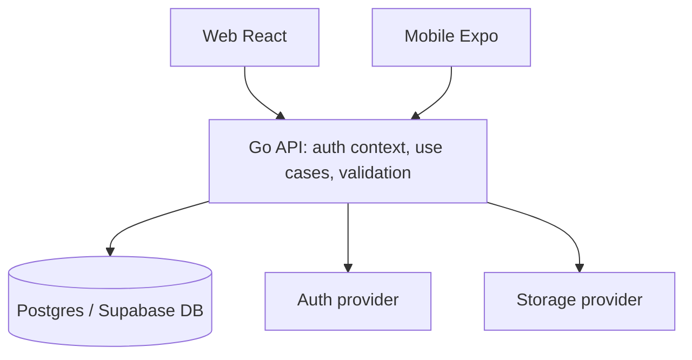

# Arah arsitektur: Go melayani web dan mobile

## Tujuan yang harus dibawa ke sesi implementasi

**Seluruh layanan bisnis meroo.gi akan menuju Go sebagai backend utama bersama untuk web dan mobile.** Frontend bertanggung jawab atas presentasi, interaksi, dan state tampilan. Go bertanggung jawab atas aturan bisnis, identitas/izin operasi, validasi input, harga final, transisi order, assignment, keuangan, dan konsistensi data.

Ini objective masa depan. Saat ini Go belum menutupi seluruh use case; mengganti import client web tidak cukup untuk mencapai target.

## Kondisi dan tujuan

| Lapisan | Kondisi saat ini | Tujuan |
|---|---|---|
| Web | Supabase Auth/PostgREST/Storage langsung | Business read/write melalui API Go; adapter HTTP browser |
| Mobile | Supabase langsung + Go + fallback Supabase | Business read/write melalui API Go; adapter native dan lifecycle token |
| Business logic | Tersebar di komponen, handler, trigger | Use case Go bersama; invariant database tetap dijaga |
| SQL | Skema lokal drift, perubahan remote belum diketahui | Migration versioned yang dapat direproduksi dan diverifikasi |
| API client | goApi.ts mobile dan MerooApiClient shared berbeda | Kontrak/version/error/payload bersama; adapter platform terpisah bila dibutuhkan |
| Auth | Supabase session dan JWT guard Go | Go mengotorisasi semua akses bisnis; provider Auth dapat tetap Supabase |
| Storage | Upload/public URL langsung client | Go mengotorisasi upload/akses dan mencatat metadata; mekanisme upload dipilih eksplisit |
| Finance/statistik | Rumus client dan backend berbeda | Perhitungan resmi Go, snapshot/ledger yang jelas |
| Sync | Refresh manual/polling berbeda | Kebijakan invalidasi, pagination dan polling/event bersama |

Supabase sebagai infrastruktur tidak perlu langsung diganti. Jika maksud jangka panjang juga menghapus Supabase Auth/Storage, itu keputusan infrastruktur terpisah dengan migrasi akun dan media, bukan konsekuensi otomatis penggunaan Go.

## Batas Auth dan file transfer

Tahap migrasi dapat mempertahankan Supabase SDK untuk memperoleh session/token, sementara semua operasi domain pindah ke Go. Untuk target akhir yang benar-benar hanya mengekspos Go sebagai backend publik, login/register/recovery/OAuth perlu facade/kontrak Go dan adapter cookie browser/token mobile. Detail penyimpanan session harus dirancang sebelum implementasi; jangan memaksa satu mekanisme penyimpanan yang sama pada browser dan perangkat.

Signed upload atau signed download yang diterbitkan Go dapat menjadi pengecualian data-plane yang disetujui: izin tetap ditentukan Go, byte file menuju storage. Jika definisi akhir menuntut seluruh traffic melalui Go, gunakan proxy upload/download. Pilihan ini belum diputuskan; tidak boleh diam-diam mempertahankan public bucket untuk credential/bukti sensitif lalu menyebut migrasi selesai.

## Gap API dan kontrak yang diperlukan

Path pada kolom target adalah **usulan kontrak**, bukan route yang sudah tersedia.

| Domain | Go saat ini | Tambahan/perubahan yang dibutuhkan |
|---|---|---|
| Identity | resolve-identifier, GET /me, PATCH /me/profile | Username uniqueness, canonical contact/phone, capability role, lifecycle Auth yang konsisten |
| Katalog publik | Tidak ada read katalog | GET /services, /services/{id}, /categories, /services/{id}/tiers; active/archive, search dan pagination |
| Review publik | Admin edit/delete saja | GET /services/{id}/reviews dengan agregat rating/count dan pagination |
| Quote/checkout | Tidak ada | POST /quotes dan /orders atau /checkout; harga/jam resmi, tier snapshot, validasi consumer, idempotency |
| Order list/detail | Cancel/receipt/progress ada, list/detail belum | GET /orders, /orders/{id}; filter milik sendiri/assigned/admin, status, deadline, allowed_actions |
| Progres | POST/PATCH ada | GET histori; konsistensi log/order/counter, policy bukti, konflik edit dan reopen |
| Checklist | List/create/toggle ada | Ownership/role guard, DELETE, edit detail bila dibutuhkan, aturan tanggal dan duplicate task |
| Vault/kode | Simpan/baca/request/submit ada | Reject terminal save, fail-safe error, TTL kode/request jika dipilih, audit akses, larangan cache sensitif |
| Pesan | Tidak ada | GET/POST /orders/{id}/messages; cursor, dedup/idempotency, peserta, status kirim |
| Review pelanggan | Tidak ada create | POST /orders/{id}/review; completed+owner+unique, agregasi atomik |
| Worker sendiri | Profile umum, progress | PATCH /me/availability; GET assigned/history/workload, hak staff/order yang eksplisit |
| Admin assignment | Candidate/assign ada | Manual dan auto memakai eligibility sama; transaksi/locking atau konflik kapasitas yang aman |
| Admin katalog | DELETE service saja | Create/update/read service/category/tier; archive/unarchive policy; larangan cascade histori |
| Admin akun | List/role/account/invites ada | Lifecycle invite, validasi promosi/penonaktifan, audit, kebijakan self-demotion/last-admin, hasil parsial Auth |
| Finance | Summary/settings, allocation pada assign | Definisi revenue/escrow resmi, histori rasio, list allocations, koreksi/reassign; payout hanya bila use case disepakati |
| Dashboard | Belum ada agregasi lengkap | Ringkasan consumer/worker/admin, periode statistik/timezone dan ukuran metrik jelas |
| Media | Tidak ada | Otorisasi upload/avatar/bukti, size/type validation, metadata ownership, cleanup bila operasi batal |
| Observability | Logger/recoverer/health | Request ID, error terstruktur, audit aksi sensitif, readiness dependency, log tanpa credential |

Jangan membuat client memanggil endpoint usulan sebelum backend dan kontraknya tersedia.

## Invariant bisnis yang harus menjadi satu versi

1. Registrasi publik tidak dapat memilih role istimewa. Role dan ownership diverifikasi Go untuk setiap resource.
2. Hanya consumer yang boleh membuat order pelanggan; harga dan jam final dihitung dari katalog server. Payload client bukan sumber nilai keuangan resmi.
3. Checkout mempunyai idempotency yang didefinisikan per user/request; retry menghasilkan order yang sama, bukan pengulangan insert.
4. Assignment tidak membuktikan pembayaran. Rancangan transisi mengacu pada pending/paid/in_progress/completed/cancelled dan memisahkan status pembayaran jika dibutuhkan.
5. Manual assignment dan auto assignment menghormati kapasitas, availability, seniority, role, dan terminal state secara sama.
6. Progres/log/status/completed_at/counter/deadline harus konsisten. Koreksi order selesai bukan efek samping edit angka tanpa kebijakan reopen.
7. Wipe credential, penutupan akses dan penyimpanan ulang setelah terminal mengikuti satu aturan. Owner/admin/assigned worker berbeda hak.
8. Checklist dan pesan hanya tersedia untuk peserta yang diizinkan; service-role tidak menggantikan pemeriksaan tersebut.
9. Review hanya milik order pelanggan yang selesai, satu per order; edit/delete memperbarui rating dalam unit kerja yang konsisten.
10. Archive service melestarikan histori order. Penghapusan akun mempunyai kebijakan retensi, bukan cascade tanpa kajian.
11. Allocation historis tidak dihitung ulang diam-diam menggunakan rasio terbaru; perubahan rasio/reassignment mempunyai definisi eksplisit.
12. UI tidak boleh mengubah hasil penolakan Go menjadi sukses melalui fallback write langsung Supabase.

## Struktur implementasi yang dituju

Pertahankan Go sebagai satu aplikasi backend modular terlebih dahulu; tidak ada kebutuhan yang membuktikan microservices harus dibuat sekarang. Pemisahan tanggung jawab yang diusulkan:

- HTTP transport: decoding, auth context, response/status/error.
- Use cases: checkout, cancel, assign, post/correct progress, manage review, invite worker, finance.
- Domain: role/action, status transition, pricing, eligibility, amount allocation.
- Repository/unit of work: query dan transaksi database.
- Provider adapters: Auth, Storage, notification bila kelak diperlukan.
- Contract: request/response/schema/error code dan versioning.

Nama folder detail diputuskan pada implementasi. File handler saat ini cukup besar; tujuan pemisahan adalah kemampuan menguji invariant, bukan refactor seluruh proyek tanpa milestone.

## Data dan transaksi

Go sekarang memakai beberapa request PostgREST, kadang paralel. Itu tidak membentuk transaksi bersama. Untuk invariant lintas tabel, fase desain perlu memilih akses PostgreSQL transactional dari Go atau database function/RPC dengan batas transaksi jelas. Pilihan harus mempertimbangkan deployment/pooling/secret yang benar-benar digunakan.

Migration perlu melengkapi username/contact, tier fixed_price/estimated_hours, worker_invites dan constraint yang dipakai code; sinkronkan tipe yang dipublikasikan. Bandingkan skema remote secara read-only dalam sesi berizin sebelum membuat SQL perubahan. Dokumen ini tidak mengasumsikan remote kosong.

Trigger tidak perlu dihapus seluruhnya. Tetapkan siapa pemilik setiap derived field: misalnya counter dari transaksi atau trigger, bukan keduanya sekaligus menambah. Migrasi bertahap harus menjaga client lama yang masih aktif.

## Kontrak frontend bersama

- Versi API /v1 dipertahankan selama kontrak kompatibel; perubahan breaking memerlukan strategi versi/masa transisi.
- ID stabil, enum status/role/seniority canonical, nominal rupiah integer, tanggal kalender terpisah dari timestamp UTC.
- Error code stabil disertai message aman dan field errors; bedakan unauthorized, forbidden, conflict, validation, unavailable.
- Read list mempunyai pagination/cursor dan filter yang sama. Jangan memuat seluruh orders/reviews/users hanya untuk satu ringkasan.
- Mutation response mengembalikan keadaan terbaru dan resource yang perlu di-refresh; sertakan revision/conflict strategy untuk data yang bisa diedit bersamaan.
- Tipe contract dapat dibagikan ke frontend; jangan mengirim model database/service-role mentah sebagai kontrak publik.
- Uji contract mencakup web dan mobile, termasuk unauthorized dan retry, bukan hanya respons sukses.

## Migrasi bertahap tanpa perilaku ganda permanen

1. Catat seluruh query/mutasi langsung di kedua frontend dan hubungan trigger.
2. Stabilkan schema dan guard endpoint yang sudah ada.
3. Tambahkan business API yang hilang beserta contract test.
4. Migrasikan satu domain lengkap, termasuk read, write, error, refresh, dan media terkait.
5. Verifikasi perbandingan hasil lintas client pada data yang sama.
6. Cabut fallback direct database untuk domain tersebut setelah fase transisi terencana.
7. Perketat akses public client agar operasi domain tidak dapat melewati Go; Auth/media exception harus terdokumentasi.
8. Pantau versi APK lama dan rollback. Backend backward compatibility perlu didefinisikan sebelum menutup akses yang masih digunakan client lama.

Tidak ada shadow write/double-write tanpa strategi konsistensi. Membaca hasil pembanding dapat membantu, tetapi dua jalur mutasi aktif untuk satu aksi bukan target akhir.

## Selesai secara arsitektur ketika

Semua operasi bisnis yang dipakai web/mobile terdaftar dan dilayani Go; kedua client memakai kontrak sama; tidak ada fallback domain ke PostgREST; akses langsung dibatasi; aturan diuji pada role dan konflik nyata; telemetry membuktikan deployment yang dipakai; exception Auth/media tertulis dan sesuai keputusan. Build APK atau web yang sukses saja belum memenuhi kondisi ini.
